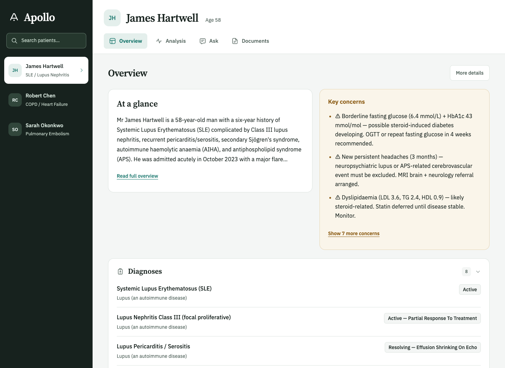
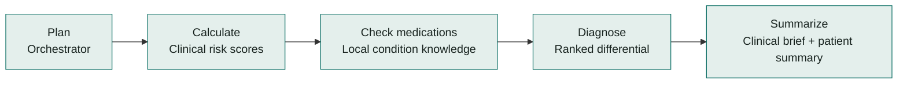
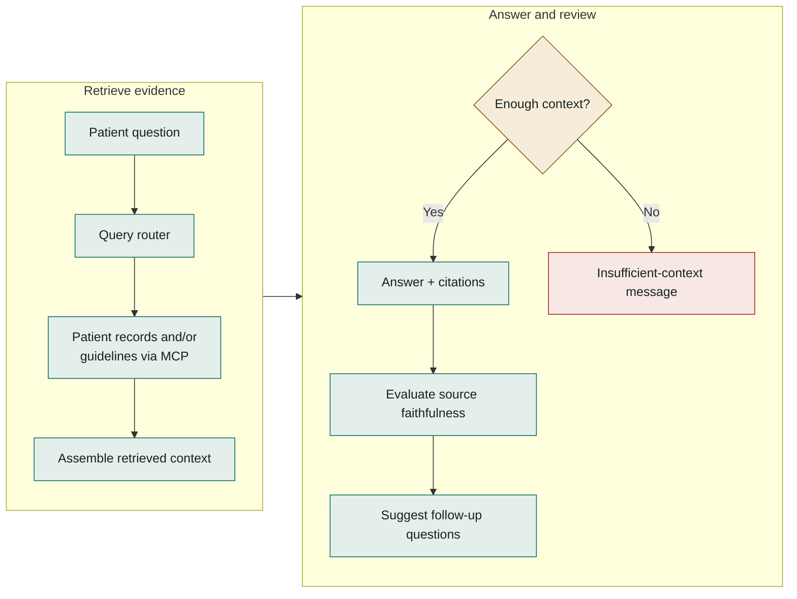

# Apollo

**Clinical records. Connected evidence. Clearer answers.**

A multi-agent clinical intelligence workspace for exploring patient records, reviewing medications and risk scores, and asking questions grounded in retrieved evidence.

[](https://github.com/anushacodes/apollo-healthcare-agent/actions/workflows/lint.yml)


[Architecture](#architecture) · [Quick start](#quick-start) · [Tech stack](#tech-stack) · [Development guide](docs/DEVELOPMENT.md) · [API reference](docs/API.md)

## What Apollo does

- **Patient overview** — diagnoses, medications, laboratory results, and key concerns in one readable record.
- **Clinical analysis** — a LangGraph workflow combines medication checks, condition knowledge, clinical calculators, and summarization.
- **Evidence-grounded answers** — patient records and clinical guidelines retrieved with SQLite FTS5 and optional Qdrant vectors.
- **Live feedback** — answers stream with citations, followed by source-review scores and suggested follow-up questions.
- **Document retrieval** — text ingestion by default; optional PDF, Word, and image extraction with local models.

<details>
<summary>View the workspace</summary>



</details>

## Architecture

### System overview

[](assets/architecture.svg)

The React workspace communicates with FastAPI over REST and WebSockets. LangGraph runs two workflows: clinical analysis and question answering. Both use shared provider clients and local clinical context; question answering also retrieves patient records and guidelines.

SQLite stores sparse indexes and caches. Qdrant adds optional dense retrieval. Guideline search runs through an in-memory MCP client/server connection, with the same tool available to external clients at `/mcp/`. Gemini¹ is used for summary fallback only.

[Explorable diagram](docs/diagrams/system.html) · [Diagram source and validation](docs/diagrams/README.md)

### Clinical analysis



The diagnostics graph is sequential. Structured patient fields supply calculator inputs for ASCVD, Wells DVT, and CHA₂DS₂-VASc; an LLM can augment the plan. Calculator and agent findings feed downstream reasoning and the final summary. Every stage emits an audit event.

### Evidence-grounded question answering



The router selects patient records, guidelines, or both; the diagram groups those retrieval branches for readability. Retrieval fuses dense and sparse results using reciprocal rank fusion; web search fills gaps when research evidence is sparse. The sufficiency check currently uses chunk count. [View the detailed retrieval flow](docs/diagrams/README.md#detailed-retrieval-flow).

The answer appears before evaluation finishes. Subsequent events add review scores, warnings, and follow-up questions. Evaluation annotates the response; it does not block its initial display. Eligible answers are cached for seven days; low-faithfulness, hallucination-flagged, or unevaluated answers are not cached. Indexing a document invalidates that patient's answer cache.

## Quick start

**Requirements:** Python 3.12, [uv](https://docs.astral.sh/uv/), and Node.js 24 LTS.

```bash
git clone https://github.com/anushacodes/apollo-healthcare-agent.git
cd apollo-healthcare-agent
cp .env.example .env
```

Add a **Groq** or **OpenRouter** API key to `.env`, then install and run:

```bash
uv sync --frozen --group dev
npm --prefix app/frontend-src ci
npm --prefix app/frontend-src run build
uv run --frozen uvicorn app.main:app --reload --port 8000
```

Open **[localhost:8000](http://localhost:8000)**. Explore **Overview**, run **Analysis**, ask a question in **Ask**, or read source records in **Documents**.

No key is needed to browse records, ingest text, use sparse retrieval, or run calculator and heuristic fallbacks. Generated answers and model-based evaluation require Groq or OpenRouter.

<details>
<summary>Optional: dense retrieval and document models</summary>

```bash
uv sync --frozen --group dev --extra inference
docker compose up -d qdrant
uv run --frozen --extra inference uvicorn app.main:app --reload --port 8000
```

The `inference` extra installs Docling and sentence-transformers. It enables PDF/Word/image extraction and dense embeddings using `BAAI/bge-small-en-v1.5`. Models download on first use. SQLite retrieval continues to work when Qdrant is unavailable.

</details>

<details>
<summary>Run with Docker</summary>

After creating `.env` and adding a generation key:

```bash
docker compose up --build
```

Compose starts the API and Qdrant. The image includes the frontend build and full CPU inference stack. Runtime data is persisted through the configured volume mounts.

</details>

See the [development guide](docs/DEVELOPMENT.md) for hot reload, configuration, model setup, and troubleshooting notes.

## Tech stack

| Layer | Technology |
| --- | --- |
| Workspace | React 19, TypeScript, Tailwind CSS, Vite |
| API and streaming | FastAPI, REST, WebSockets |
| Agent orchestration | LangGraph, Pydantic, Instructor |
| Model providers | Groq, OpenRouter; Gemini for summary fallback |
| Retrieval and caching | SQLite FTS5, Qdrant, reciprocal rank fusion |
| Guideline tools | FastMCP, local curated corpus |
| Document processing | Docling, sentence-transformers (`inference` extra) |
| Web search | Tavily, DuckDuckGo fallback |
| Tooling | uv, Ruff, pytest, Oxlint, GitHub Actions, Docker Compose |

## Project structure

```text
app/
├── agent/
│   ├── diagnostics/     # Clinical analysis graph
│   ├── rag/             # Retrieval, generation, and evaluation graph
│   └── …                # Specialist agents, calculators, prompts, caches
├── ingestion/           # Parsing, chunking, and hybrid search
├── mcp/                 # Guideline search server and client
├── routers/             # REST and WebSocket endpoints
└── frontend-src/        # React workspace
data/
├── seed/                # Patient source records
└── corpus/              # Curated guideline documents
knowledge_graph/         # Local condition knowledge blocks
tests/                   # Offline regression tests
docs/                    # API, development, diagrams, and roadmap
```

## Development checks

```bash
uv run --frozen ruff check .
uv run --frozen pytest -q
npm --prefix app/frontend-src run lint
npm --prefix app/frontend-src run build
```

CI checks Python lint, offline tests, and frontend lint/typecheck/build. Tests isolate SQLite, disable credentials and network access, and mock external services. They cover graph routing, streaming, ingestion, evaluation, caching, patient isolation, and MCP retrieval.

## Project status

Apollo is a portfolio project using synthetic patient records. It is not clinically validated and has no authentication or patient authorization. The workspace currently browses three bundled cases; uploaded document namespaces are available through the API and do not create new patients in the selector.

Patient management, application tracing, production deployment, and live provider/model/container validation remain open. See the [completion audit and roadmap](docs/TASKS.md).

---

README structure inspired by [Healthcare Voice Agent](https://github.com/santiago68310/Healthcare-voice-agent). Architecture diagrams describe Apollo's own implementation.
