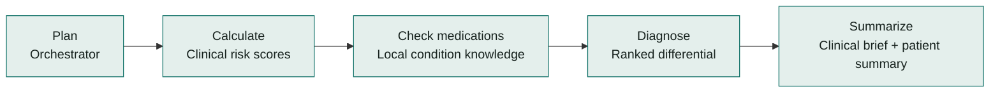
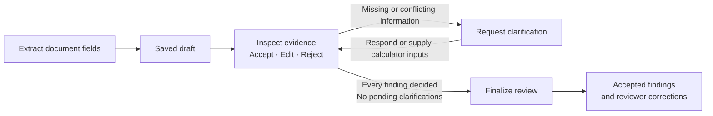
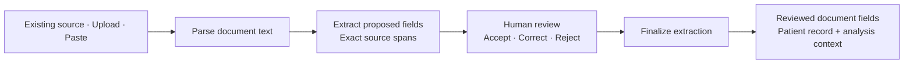
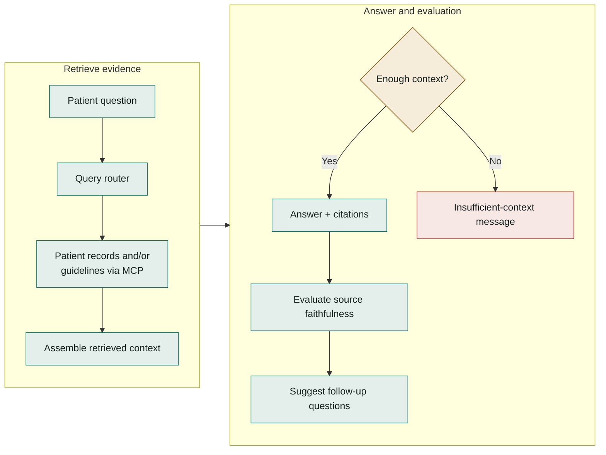

# Apollo

**Clinical records. Connected evidence. Clearer answers.**

A multi-agent clinical intelligence workspace for exploring patient records, reviewing medications and risk scores, and asking questions grounded in retrieved evidence.

[](https://github.com/anushacodes/apollo-healthcare-agent/actions/workflows/lint.yml)


[Architecture](#architecture) · [Quick start](#quick-start) · [Tech stack](#tech-stack) · [Development checks](#development-checks) · [Documentation](docs/README.md)

## What Apollo does

- **Patient overview** — diagnoses, medications, laboratory results, and key concerns in one readable record.
- **Clinical analysis** — a LangGraph workflow combines medication checks, condition knowledge, clinical calculators, and summarization.
- **Human review** — saved drafts with highlighted source evidence, accept/edit/reject decisions, clarification requests, and a gated final output.
- **Evidence-grounded answers** — patient records and clinical guidelines retrieved with SQLite FTS5 and optional Qdrant vectors.
- **Live feedback** — answers stream with citations, followed by source-review scores and suggested follow-up questions.
- **Document retrieval** — plain text and selectable-text PDFs by default; optional scanned PDF, Word, and image extraction with local models.
- **Reviewed extraction** — English document fields with exact source passages, structured corrections, and approval before they enter the patient record.

<details>
<summary>View the workspace</summary>


</details>

## Architecture

### System overview

[](assets/architecture.svg)

The React workspace communicates with FastAPI over REST and WebSockets. LangGraph runs two workflows: clinical analysis and question answering. Both use shared provider clients and local clinical context; question answering also retrieves patient records and guidelines.

SQLite stores sparse indexes, caches, reviewer sessions, analysis drafts, decisions, and a per-analysis hash-chained audit trail. Qdrant adds optional dense retrieval. Guideline search runs through an in-memory MCP client/server connection, with the same tool available to external clients at `/mcp/`. Gemini¹ is used for summary fallback only.

### Clinical analysis



The diagnostics graph is sequential. Structured patient fields supply calculator inputs for ASCVD, Wells DVT, and CHA₂DS₂-VASc; an LLM can augment the plan. Calculator and agent findings feed downstream reasoning and the final summary. Every stage emits an execution event. A wrapper then saves the analysis as a reviewable draft; the LangGraph itself does not pause for human approval.

### Human-in-the-loop review



In **Analysis**, run a case, enter a reviewer name, and inspect each finding's linked source passages. Findings distinguish **documented**, **suspected**, **historical**, **negated**, **conflicting**, **AI suggested**, and **calculated** information. The matcher uses exact text and simple assertion rules; a linked passage is provenance, not proof that a generated interpretation is correct.

Every decision requires a reason and records the reviewer session, original suggestion, correction, and timestamp. Missing or conflicting evidence blocks unchanged acceptance. Reviewers can instead edit with a reason, reject, or ask for clarification. Clarification responses are marked **reviewer supplied** and return the finding to pending review.

Missing calculator inputs are collected explicitly or the calculator can be skipped with a reason. Saving inputs reruns that calculator and refreshes the diagnostic and summary drafts. Those dependent findings require fresh review. Saved analyses and decisions survive reloads and server restarts.

The API rejects stale versions and prevents finalization until every finding has a decision and all clarifications are resolved or skipped. The finalized endpoint returns only accepted findings and reviewer corrections; rejected findings remain in history. Finalized reviews are immutable. **Ask answers remain immediate, model-evaluated responses and are outside this human-review gate.**

Reviewer names are self-declared local identities, carried in server-issued HttpOnly cookie sessions. They are **not verified accounts or clinical sign-off**. The audit hash chain detects edits against the retained chain; it is not an externally anchored, tamper-proof log.

### Document extraction

In **Documents**, extract fields from an existing source, upload a file, or paste document text. Apollo proposes patient details, diagnoses, medications, laboratory results, allergies, dates, and recorded follow-up actions. Each proposal links to its exact source passage. Reviewers can accept, correct structured fields, reject, or request clarification before selecting **Finalize and save fields**.



Approved fields appear in **Overview → Reviewed document fields**, with their source, reviewer, recorded date, and status. Original proposals and corrections remain in the audit history. Historical prescriptions, held medications, and negated diagnoses retain those distinctions; imports do not overwrite the current medication or diagnosis lists. Reimporting the same document and approved values does not duplicate record entries.

The extractor uses conservative English rules for explicit labels, medication lists with doses, and five-column laboratory tables in Markdown or aligned PDF text. It requires no generation key. Ambiguous numeric dates are flagged for confirmation, missing doses are not inferred, and unlabeled narrative may produce no fields. Documents support up to 100,000 characters per extraction. Selectable-text PDFs use the lightweight pypdf parser; scanned PDFs, Word, and images require the optional local model stack. Uploaded text remains available to retrieval before its structured proposals are approved.

### Evidence-grounded question answering



The router selects patient records, guidelines, or both; the diagram groups those retrieval branches for readability. Retrieval fuses dense and sparse results using reciprocal rank fusion; web search fills gaps when research evidence is sparse. The sufficiency check currently uses chunk count.

Generation and evaluation receive the same numbered evidence excerpts, including the later laboratory sections of structured records. Evaluation checks the full generated answer. A patient-record question can use a single available source.

Answers must include numbered citations to the supplied sources. Missing citations or unknown source numbers trigger one regeneration attempt; persistent failures return an error. This checks reference validity, while model-based evaluation assesses whether the claims are supported.

The answer appears before evaluation finishes. Subsequent events add review scores, warnings, and follow-up questions. Evaluation annotates the response; it does not block its initial display. Eligible answers are cached for seven days; low-faithfulness, hallucination-flagged, or unevaluated answers are not cached. Indexing a document invalidates that patient's answer cache.

## Quick start

**Requirements:** Python 3.12, [uv](https://docs.astral.sh/uv/), and Node.js 24 LTS.

```bash
git clone https://github.com/anushacodes/apollo-healthcare-agent.git
cd apollo-healthcare-agent
cp .env.example .env
```

Add a **Groq** or **OpenRouter** API key to `.env`, then install and run:

```bash
uv sync --group dev
npm --prefix app/frontend-src install
npm --prefix app/frontend-src run build
uv run --frozen uvicorn app.main:app --reload --port 8000
```

Open **[localhost:8000](http://localhost:8000)**. Explore **Overview**, run **Analysis**, ask a question in **Ask**, or read source records in **Documents**.

No key is needed to browse records, ingest text, use sparse retrieval, or try the human-review workflow with calculator and heuristic fallbacks. Generated answers and model-based evaluation require Groq or OpenRouter.

Restart the backend after editing `.env`. Ask reports missing or rejected keys, rate limits, unavailable credits, connection failures, and timeouts with specific next steps. Provider requests use a 30-second timeout and fall back to the other provider when it is configured.

<details>
<summary>Try the connected document workflow</summary>

Select **Robert Chen**, then upload these actual PDF files in **Documents → Add document**, in order:

1. [Clinic follow-up](data/demo_documents/robert_chen/01_clinic_follow_up.pdf) — patient details, diagnoses, a negated finding, and a recorded follow-up action.
2. [Medication review](data/demo_documents/robert_chen/02_medication_review.pdf) — structured corrections, metformin's held status, and aspirin allergy evidence.
3. [Laboratory report](data/demo_documents/robert_chen/03_laboratory_report.pdf) — values, units, recorded flags, and distinct sample/report dates.

Inspect source passages, review every field, and select **Finalize and save fields**. Show the approved entries in **Overview**, reload to demonstrate persistence, then run **Analysis**. With a generation key configured, ask “Which medication is held?” or “What reaction to aspirin is recorded?” and inspect citations.

Matching text exports are available alongside the PDFs. All three documents contain clearly labeled synthetic records; no real patient data is included. The PDFs work with the default install and need no OCR model download.

</details>

<details>
<summary>Optional: dense retrieval and document models</summary>

```bash
uv sync --group dev --extra inference
docker compose up -d qdrant
uv run --frozen --extra inference uvicorn app.main:app --reload --port 8000
```

The `inference` extra installs Docling and sentence-transformers. It enables scanned PDF/Word/image extraction and dense embeddings using `BAAI/bge-small-en-v1.5`. Models download on first use. SQLite retrieval continues to work when Qdrant is unavailable.

</details>

<details>
<summary>Run with Docker</summary>

After creating `.env` and adding a generation key:

```bash
docker compose up --build
```

Compose starts the API and Qdrant. The image includes the frontend build and full CPU inference stack. Runtime data is persisted through the configured volume mounts.

</details>

For frontend hot reload, keep the API running and run `npm --prefix app/frontend-src run dev` in a second terminal. Vite proxies API requests and WebSockets to port 8000. Explore the running API at [localhost:8000/docs](http://localhost:8000/docs).

## Tech stack

| Layer | Technology |
| --- | --- |
| Workspace | React 19, TypeScript, Tailwind CSS, Vite |
| API and streaming | FastAPI, REST, WebSockets |
| Agent orchestration | LangGraph, Pydantic, Instructor |
| Model providers | Groq, OpenRouter; Gemini for summary fallback |
| Retrieval and caching | SQLite FTS5, Qdrant, reciprocal rank fusion |
| Guideline tools | FastMCP, local curated corpus |
| Document processing | pypdf; Docling and sentence-transformers (`inference` extra) |
| Web search | Tavily, DuckDuckGo fallback |
| Tooling | uv, Ruff, pytest, Oxlint, GitHub Actions, Docker Compose |

## Project structure

```text
app/
├── agent/
│   ├── diagnostics/     # Clinical analysis graph
│   ├── rag/             # Retrieval, generation, and evaluation graph
│   └── …                # Specialist agents, calculators, prompts, caches
├── ingestion/           # Parsing, chunking, and hybrid search
├── mcp/                 # Guideline search server and client
├── review/              # Evidence, review state, decisions, and clarifications
├── routers/             # REST and WebSocket endpoints
└── frontend-src/        # React workspace
data/
├── seed/                # Patient source records
├── corpus/              # Curated guideline documents
└── evaluation/          # Labeled synthetic review-policy cases
knowledge_graph/         # Local condition knowledge blocks
tests/                   # Offline regression tests
```

## Development checks

```bash
uv run --frozen ruff check .
uv run --frozen pytest -q
npm --prefix app/frontend-src run lint
npm --prefix app/frontend-src run build
uv run --frozen python -m app.evaluation
uv run --frozen python -m app.ingestion.evaluate_extraction
```

CI checks Python lint, offline tests, and frontend lint/typecheck/build. Tests isolate SQLite, disable credentials and network access, and mock external services. They cover graph routing, streaming, ingestion, evaluation, caching, patient isolation, MCP retrieval, review state transitions, stale edits, reviewer-session enforcement, clarification, and audit integrity.

The offline evaluation harness checks 10 labeled synthetic cases for assertion handling, exact evidence offsets, conflicting records, missing inputs, unsupported drafts, and insufficient-context refusal. This is a policy regression set, not an LLM-quality or clinical validation benchmark.

A separate extraction regression set contains 10 hand-labeled synthetic English documents covering structured fields, assertion status, held and historical medications, dates, duplicate proposals, missing doses, and source offsets. Tests also check known results from the bundled Case A laboratory report. These fixtures do not establish accuracy on arbitrary clinical documents.
