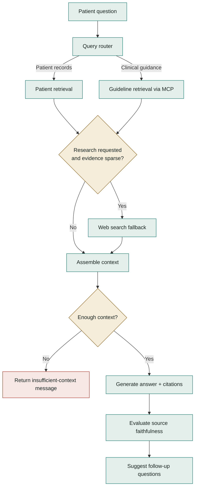

# Architecture diagrams

[Back to Apollo](../../README.md)

- [System overview SVG](../../assets/architecture.svg) — dual-theme vector embedded in the README; exported through the viewer's canonical SVG export.
- [Explorable architecture](system.html) — download and open locally for zoom, focus, theme switching, and export. GitHub displays HTML as source.
- [Editable architecture specification](system.architecture.json).
- The clinical-analysis and question-answering diagrams are authored directly as Mermaid blocks in the root README and render natively on GitHub.

## Implementation evidence

| Diagram concept | Repository source |
| --- | --- |
| API, static workspace, MCP mount | [`app/main.py`](../../app/main.py) |
| Sequential diagnostics graph | [`app/agent/diagnostics/graph.py`](../../app/agent/diagnostics/graph.py) |
| Conditional RAG routing and stream events | [`app/agent/rag/graph.py`](../../app/agent/rag/graph.py) |
| Hybrid indexes | [`app/ingestion/embedder.py`](../../app/ingestion/embedder.py) |
| Sparse storage and caches | [`app/agent/sqlite_cache.py`](../../app/agent/sqlite_cache.py) |
| In-memory guideline MCP connection | [`app/mcp/client.py`](../../app/mcp/client.py) |
| Clinical condition library | [`app/agent/kg_loader.py`](../../app/agent/kg_loader.py) |

The architecture is a component map, not a production deployment topology. External web-search fallback and the answer cache are described in the workflow text rather than drawn as separate overview nodes. The superscript on Gemini refers to its summary-only fallback role.

## Diagram validation

Created with the local Archify skill. The specification and trusted HTML passed all **9 showcase artifact checks**, with **0 composition errors and 0 warnings**. Chrome checks passed at 1440×900, 1600×1000, 1920×1080, and 2048×1320. Light and dark screenshots were inspected for clipping, label collisions, and legibility; visual review passed.

```text
diagram_type: architecture
output: docs/diagrams/system.html
specification_sha256: ea496822c43bcaca7b136a390e8fb7d3cc889d5e3a3bdb7198df07a945bde110
artifact_sha256: 86bf1bc02553aa13801a185fbbd5d0b2b1958b32c6c830613df0bc6c4a14a764
validation: 9/9 showcase, 0 errors, 0 warnings
browser_evidence: passed
visual_review: passed
correction_rounds: 2
```

To regenerate with Archify installed, validate the JSON and run `deliver architecture` before exporting a new SVG. Keep the overview consistent with the graph implementations when changing pipeline behavior.

## Detailed retrieval flow

This expands the retrieval branches and web fallback grouped in the root README.


